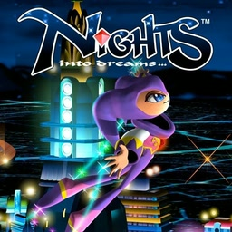

<p align=center></p>

<h1 align=center>NiGHTS into Dreams... — Nintendo Switch port</h1>

<p align=center><b>nights-nx 1.0.3</b> · <a href="https://chanseyisthebest.github.io/nights-nx-installer/">web installer</a> · <a href="https://github.com/ChanseyIsTheBest/nights-nx/releases/tag/v1.0.3">release</a></p>

An unofficial native port of the Xbox 360 (Xbox Live Arcade) version of **NiGHTS into Dreams...**, made by static
recompilation with [ReXGlue](https://github.com/rexglue/rexglue-sdk) and drawn by reNut's renderer on deko3d. No
emulator. Built on the [ultimate base](https://github.com/ChanseyIsTheBest/renut_nx_ultimate_base) with its fixes and
speed-ups.

This repository contains no game files (and no shaders made from them). You need your own copy of the game: its Xbox
Live Arcade package (`Content/0000000000000000/58411268/000D0000/`) and its title update (`000B0000/`, or the `TU_...`
file in the console's `Cache` folder).

## Playing it on the Switch

1. Open the web installer: **https://chanseyisthebest.github.io/nights-nx-installer/**
   ([source](https://github.com/ChanseyIsTheBest/nights-nx-installer)).
2. Give it the game's package and its title update. It makes the shaders in your browser; nothing is uploaded.
3. Extract the zip it gives you to the root of your SD card.
4. Start `switch/nights-nx/nights-nx.nro` from the Homebrew Menu with a title takeover (hold R while starting a game).

Features:

- 60 fps by default; 30 is an option.
- Game menu (hold A+B+X+Y+L+R, + closes it): language, frame rate, handheld and docked resolutions, SMAA, MSAA,
  controls.
- SMAA edge smoothing (HUD and text stay sharp) and 2x / 4x MSAA.
- 1280x720 handheld, 1920x1080 docked; double buffering with an input-lag fix.
- Smaller install (68 % smaller): packed game files, H.265 movies and Opus music.
- Logging off. For a bug report, set `log_level = "info"` in `switch/nights-nx/renut.toml`.

## Settings

`switch/nights-nx/renut.toml` is written at the first start (the game menu writes it too). Any setting in it overrides
the built-in one.

| Setting | Default | |
|---|---|---|
| `language` | `"auto"` | the Switch's language; or english, japanese, french, german, spanish, italian |
| `banjo_renut_smaa` | `true` | SMAA edge smoothing |
| `nights_true60` | `true` | `true` = 60 fps, `false` = 30 fps |
| `input_xbox_layout` | `true` | face buttons by position, as on an Xbox pad; `false` = by letter |
| `input_joycon_sideways` | `true` | single Joy-Cons held sideways, one per player |
| `input_joycon_sideways_stick` | `true` | the single Joy-Con's stick turned for the sideways grip |
| `[input_p1]` | | button mapping |

## Building

Both builds need the code generated from your own `default.xex` (ReXGlue's codegen with `app/config/`); it is not in
this repository.

```bat
:: Switch (devkitA64)
tools\build_switch.bat
:: PC (reNut's renderer on Vulkan)
tools\build_pc.bat
```

More in [docs/building.md](docs/building.md), [docs/nights-notes.md](docs/nights-notes.md) and
[docs/nights-ultimate-notes.md](docs/nights-ultimate-notes.md); the base rebase and sync in
[docs/ultimate-rebase-plan.md](docs/ultimate-rebase-plan.md) and [docs/ultimate-sync.md](docs/ultimate-sync.md).

## Credits and license

- [ReXGlue](https://github.com/rexglue/rexglue-sdk): the recompiler and runtime.
- [reNut](https://github.com/masterspike52/reNut)'s renderer by masterspike52 (its author permits its reuse in these
  ports).
- The ultimate base ([renut_nx_ultimate_base](https://github.com/ChanseyIsTheBest/renut_nx_ultimate_base)) and the
  ports whose fixes it carries, named port by port in its README, [THIRD_PARTY_NOTICES.md](THIRD_PARTY_NOTICES.md) and
  [docs/ultimate-fixes.md](docs/ultimate-fixes.md). banjo-nx (renut-nx) was this port's first base.
- sa2-nx (double buffering and its queue drain, built-in settings, language setting, controls), futari-nx and
  ketsui-nx (queue drain), NetherSX2_nx, battd_nx, the bejeweled3-nx / zuma ports and peggle2-nx.
- Packed files, H.265 movies and Opus music: rr6-nx (the `.lz4b` reader), culdcept-nx (movies through FFmpeg and
  nxvideo, the VFS index of packed files), sa2-nx-ult (ADX music from Opus) and sasrt-nx (the plan).
- [LZ4](https://github.com/lz4/lz4) 1.10.0 by Yann Collet (BSD-2-Clause) and [ZXC](https://github.com/hellobertrand/zxc)
  0.15.0 by Bertrand Lebonnois (BSD-3-Clause, with [rapidhash](https://github.com/Nicoshev/rapidhash), MIT) decode
  the packed files; [libopus](https://opus-codec.org) (devkitPro's `switch-libopus`, BSD-3-Clause) the music;
  [FFmpeg](https://ffmpeg.org) 4.4's VC-1 decoder in the SDK (LGPL-2.1-or-later) and nxvideo's FFmpeg 7.1 with averne's
  nvtegra backend (devkitPro's `switch-ffmpeg`, LGPL-2.1-or-later) the H.265 movies on NVDEC.

GPL-3.0 where the sources are (see [LICENSE](LICENSE)). NiGHTS into Dreams... is SEGA's; this project is not
affiliated with SEGA.
